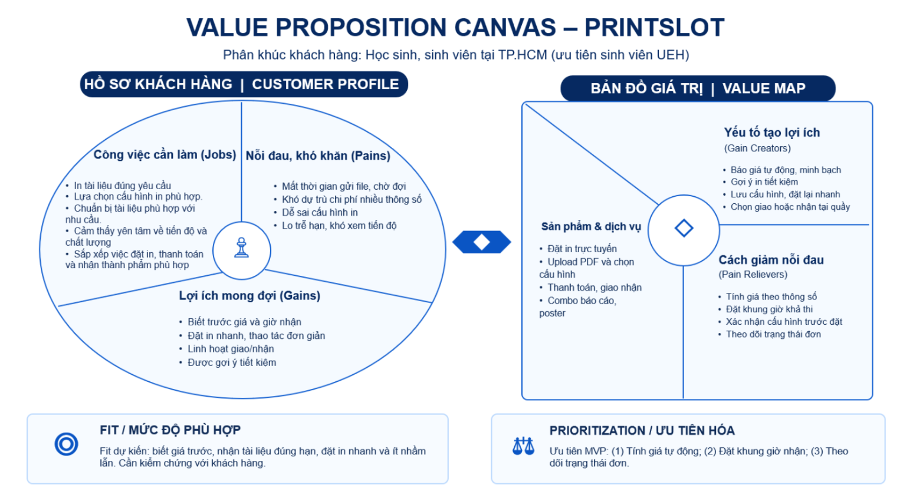
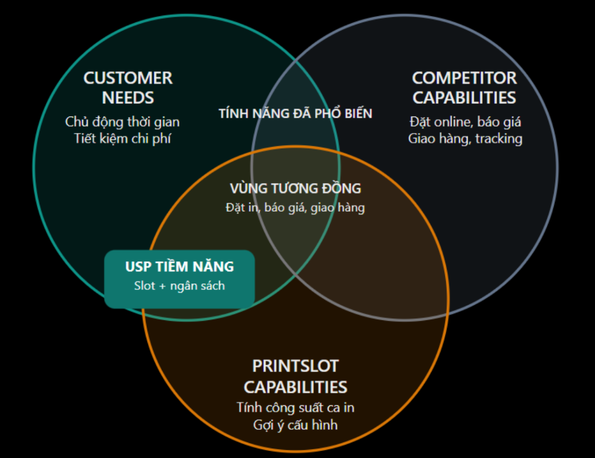

# Requirements

## 1. Mục tiêu dự án
**Tên đề tài: “PrintSlot -  Website đặt dịch vụ in ấn tài liệu theo yêu cầu dành cho học sinh, sinh viên”.**

Mục tiêu kinh doanh
- Xây dựng **PrintSlot – Website đặt dịch vụ in ấn trực tuyến**: tập trung vào học sinh, sinh viên tại TP.HCM, đặc biệt là sinh viên UEH.
- **Số hóa và tối ưu quy trình đặt in**: từ lựa chọn dịch vụ, báo giá, thanh toán đến giao nhận và theo dõi đơn hàng.
- **Nâng cao hiệu quả vận hành**: quản lý đơn hàng và năng lực xử lý của cửa hàng, đồng thời tạo lợi thế cạnh tranh bằng các tính năng thông minh.

Giá trị mang lại cho khách hàng
- **Tiết kiệm thời gian:** Đặt in trực tuyến, giảm thao tác trao đổi thủ công và thời gian chờ đợi.
- **Minh bạch và tối ưu chi phí:** Báo giá tự động, gợi ý cấu hình in phù hợp với ngân sách.
- **Chủ động thời gian nhận:** Lựa chọn khung giờ nhận dựa trên năng lực xử lý dự kiến, hạn chế rủi ro trễ deadline.
- **Thuận tiện và đáng tin cậy:** Tùy chỉnh yêu cầu in, thanh toán linh hoạt và theo dõi tiến độ đơn hàng trên một nền tảng.

### Trả lời 6 câu hỏi của GV

### 1.1. Website kinh doanh sản phẩm hoặc dịch vụ gì?

PrintSlot kinh doanh dịch vụ in ấn tài liệu theo yêu cầu, phục vụ nhu cầu học tập, làm việc và tổ chức sự kiện.

**Danh mục dịch vụ của PrintSlot**

| Tên dịch vụ | Chi tiết |
| --- | --- |
| In ấn tài liệu học tập và làm việc | In slide bài giảng, tài liệu tham khảo, slide thuyết trình, báo cáo nhóm, luận văn, khóa luận và một số tài liệu khác. |
| Tuỳ chỉnh và gia công tài liệu | Chọn số lượng mặt trên một trang, lựa chọn khổ giấy, loại giấy, đóng gáy lò xo, đóng bìa và hoàn thiện tài liệu. |
| In ấn phục vụ sự kiện | In poster, bản vẽ kỹ thuật, decal và các ấn phẩm phục vụ hoạt động truyền thông khác. |
| Định dạng & Chuẩn hóa file (Format Word) | Thực hiện định dạng, căn chỉnh margins, làm mục lục tự động,... chỉnh chuẩn bìa/font theo quy định báo cáo/khóa luận. |
| Combo dịch vụ | Combo khóa luận, combo in poster kèm standee (thuê hoặc mua). |

_**Nguồn: Nhóm tác giả đề xuất (2026)**_

Khách hàng đặt dịch vụ theo từng đơn in, với số lượng được tính theo trang, tờ, bản hoặc bộ tài liệu tùy loại dịch vụ. Khách hàng có thể lựa chọn cấu hình in, thời gian hoàn thành dự kiến, khung giờ nhận và phương thức giao nhận.

### 1.2. Khách hàng mục tiêu là ai?

**Phân tích đặc điểm khách hàng mục tiêu của PrintSlot**

| Nhóm tiêu chí | Thuộc tính | Khách hàng mục tiêu chính |
| --- | --- | --- |
| Nhân khẩu học | Độ tuổi | Khoảng 16–25 tuổi |
|  | Thu nhập | Chủ yếu sử dụng ngân sách cá nhân hoặc hỗ trợ từ gia đình; chưa xác định mức thu nhập cụ thể. |
|  | Nghề nghiệp | Học sinh THPT, sinh viên cao đẳng/đại học tại TP.HCM, ưu tiên sinh viên UEH. |
|  | Nơi sinh sống | Học tập, cư trú tại TP.HCM; ưu tiên khu vực gần các cơ sở đào tạo và điểm giao nhận dự kiến. |
| Tâm lý học | Sở thích | Quan tâm đến công cụ học tập tiện lợi, dịch vụ trực tuyến và các giải pháp tiết kiệm chi phí. |
|  | Lối sống | Lịch học, bài tập và hoạt động nhóm có thể thay đổi; cần sắp xếp thời gian hiệu quả. |
|  | Giá trị sống | Đề cao tính tiết kiệm, sự thuận tiện, chủ động trong học tập và quản lý thời gian. |
|  | Quan điểm | Có xu hướng lựa chọn dịch vụ dễ thao tác, minh bạch giá và đáp ứng thời hạn nộp bài. |
| Hành vi | Tần suất sử dụng | Phát sinh theo bài tập, kỳ thi, bài thuyết trình, báo cáo nhóm và khóa luận; có thể tăng vào giai đoạn cao điểm học kỳ. |
|  | Kênh đặt dịch vụ | Tiệm in trực tiếp, tin nhắn/Zalo hoặc website đặt in trực tuyến. |
| Hành vi | Lý do lựa chọn | Giá phù hợp, quy trình nhanh, vị trí thuận tiện, chất lượng đáp ứng yêu cầu và nhận thành phẩm đúng thời hạn. |
|  | Mức độ trung thành | Có khả năng sử dụng lại nếu giá cả, chất lượng và thời gian nhận đáp ứng kỳ vọng; dễ cân nhắc lựa chọn khác khi có dịch vụ thuận tiện hơn. |

_**Nguồn: Nhóm tác giả đề xuất (2026)**_

### 1.3. Phân tích vấn đề khách hàng và giải pháp của PrintSlot bằng mô hình Value Proposition Canvas

Mô hình Value Proposition Canvas được sử dụng để xác định công việc, khó khăn và lợi ích mong đợi của khách hàng, từ đó xây dựng giải pháp có khả năng đáp ứng các nhu cầu quan trọng.

**Tổng hợp mô hình Value Proposition Canvas của PrintSlot**

_**Nguồn: Hình ảnh có sử dụng AI**_

**Phân tích chi tiết:** [1.3. Phân tích vấn đề khách hàng và giải pháp của PrintSlot bằng mô hình Value Proposition Canvas](https://docs.google.com/document/d/1nS6s-vEdgaIkDlv0fmnZZX75G25MTObRDletDFm4PGw/edit?usp=sharing)

### 1.4. Website có điểm khác biệt gì so với các website tương tự?

**Mô hình Sweet Spot của PrintSlot**

_**Nguồn: Hình ảnh có sử dụng AI**_

**Phân tích Sweet Spot Matrix của PrintSlot**

| Thành phần | Nội dung phân tích |
| --- | --- |
| Vòng 1 - Customer Needs (Nhu cầu khách hàng) | Học sinh, sinh viên cần đặt in thuận tiện, biết trước chi phí, chọn được cấu hình phù hợp ngân sách và nhận tài liệu kịp thời. Những nhu cầu cần ưu tiên xác minh là khả năng chủ động khung giờ nhận và mức độ quan tâm đến gợi ý tiết kiệm chi phí. |
| Vòng 2 - Competitor Capabilities (Năng lực đối thủ) | Thị trường đã có những website hỗ trợ đặt in online, báo giá, tùy chỉnh ấn phẩm, thanh toán, giao hàng hoặc theo dõi đơn. Ví dụ: Print24h giới thiệu báo giá tức thì và theo dõi tiến độ; SVPrint cung cấp công cụ tính giá tự động; DTECHPRINTING hỗ trợ nhận file online và giao hàng nhanh. Đây là các năng lực PrintSlot cần đáp ứng, không thể mặc định là điểm khác biệt riêng. |
| Vòng 3 - PrintSlot Capabilities (Năng lực dự kiến của PrintSlot) | PrintSlot định hướng phát triển Smart Print Calculator (tính giá theo cấu hình), PrintSlot Scheduling (kiểm tra năng lực xử lý của từng khung giờ nhận) và Budget - friendly Printing (gợi ý cấu hình tiết kiệm). Các chức năng được thiết kế cho quy trình đặt in tài liệu học tập, báo cáo và nhu cầu in ấn theo deadline. |
| Vùng giao thoa giữa khách hàng và đối thủ | Các nhu cầu đặt in online, báo giá và giao nhận đã được một số đối thủ đáp ứng. PrintSlot cần triển khai tốt những chức năng này như năng lực cạnh tranh cơ bản. |
| Vùng giao thoa giữa khách hàng và PrintSlot - USP tiềm năng | PrintSlot hướng đến việc giải quyết đồng thời hai nhu cầu: chủ động thời gian nhận dựa trên khả năng tiếp nhận đơn thực tế của hệ thống và lựa chọn cấu hình in theo ngân sách. Đây là hướng khác biệt ưu tiên, nhưng chưa đủ cơ sở để khẳng định đối thủ không cung cấp chức năng tương đương. |

_**Nguồn: Nhóm tác giả đề xuất (2026)**_

### Tuyên bố giá trị khác biệt (USP)

“PrintSlot - Đặt in chủ động ngân sách, chủ động lịch trình, tối ưu hoá dành cho sinh viên”.

Thay vì chỉ cung cấp dịch vụ đặt in trực tuyến, PrintSlot hướng đến kết hợp báo giá tự động, lựa chọn khung giờ nhận theo năng lực xử lý và gợi ý cấu hình in tiết kiệm trên cùng một nền tảng, tập trung trước tiên vào nhu cầu của học sinh, sinh viên tại TP.HCM.

Tuyên bố này thể hiện định vị cạnh tranh dự kiến, không phải khẳng định PrintSlot sở hữu công nghệ độc quyền hoặc các đối thủ chưa có những tính năng tương tự. Nhóm sẽ kiểm chứng sự khác biệt khi phân tích chi tiết ít nhất ba website và khảo sát khách hàng mục tiêu.

### 1.5. Những chức năng nào bắt buộc phải có trong phiên bản đầu tiên?

Phiên bản đầu tiên (MVP) của PrintSlot dự kiến tập trung vào các nhóm chức năng sau:

**MVP của PrintSlot**

| Nhóm chức năng | Chức năng chính |
| --- | --- |
| Trang chủ và danh mục dịch vụ | Hiển thị các nhóm dịch vụ in ấn, gói in phổ biến, combo và chương trình khuyến mãi. |
| Tài khoản khách hàng | Đăng ký, đăng nhập, quản lý hồ sơ và xem lịch sử đặt in. |
| Tìm kiếm và lọc dịch vụ | Tìm kiếm theo từ khóa; lọc theo loại dịch vụ, mức giá, khổ giấy, màu sắc, loại giấy, hình thức in, kiểu đóng gáy và thời gian xử lý. |
| Chi tiết dịch vụ và cấu hình in | Hiển thị mô tả, giá, các tùy chọn in; cho phép tải PDF hợp lệ hoặc nhập thông tin tài liệu và số lượng bản in. |
| Tính giá tự động | Tính tổng tiền dự kiến theo cấu hình và số lượng, cập nhật khi khách hàng thay đổi lựa chọn. |
| Giỏ hàng và đặt dịch vụ | Thêm, sửa, xóa các mục đặt in; kiểm tra cấu hình và tổng tiền trước khi thanh toán. |
| Đặt khung giờ nhận | Hiển thị khung giờ có thể đáp ứng, cho phép chọn thời điểm nhận và kiểm tra lại khả năng xử lý khi xác nhận đơn. |
| Thanh toán | Tích hợp tối thiểu một phương thức thanh toán trực tuyến qua môi trường sandbox, xử lý kết quả thành công, thất bại hoặc hủy. |
| Giao nhận (Shipping) | Cho phép chọn nhận tại quầy hoặc giao đến địa chỉ khách hàng; tính phí giao hàng, lưu thông tin và trạng thái giao nhận. |
| Voucher/Promotion | Áp dụng mã giảm giá, kiểm tra thời hạn, điều kiện và số lần sử dụng; cập nhật tổng tiền đơn hàng. |
| Quản lý đơn hàng | Khách hàng xem chi tiết và theo dõi tiến độ xử lý đơn in. |
| Đánh giá và yêu thích | Cho phép đánh giá dịch vụ sau khi hoàn tất đơn, lưu các gói/cấu hình in yêu thích. |
| Quản trị hệ thống (Admin) | Quản lý danh mục, gói dịch vụ, bảng giá, khách hàng, đơn in, trạng thái xử lý và chương trình khuyến mãi. |
| Dashboard | Thống kê số đơn hàng, doanh thu, dịch vụ phổ biến, số khách hàng và đơn đang xử lý. |
| Bảo mật và giao diện | Phân quyền người dùng, kiểm tra dữ liệu đầu vào, bảo vệ file tải lên và thiết kế giao diện responsive cho máy tính, điện thoại. |

_**Nguồn: Nhóm tác giả đề xuất (2026)**_

Chức năng gợi ý cấu hình in tiết kiệm được xem là hướng mở rộng có giá trị nghiệp vụ và sẽ được triển khai sau khi các chức năng cốt lõi hoạt động ổn định.

## 2. Phạm vi
### Trong phạm vi
Đồ án tập trung xây dựng phiên bản MVP của PrintSlot – website đặt dịch vụ in ấn tài liệu học tập và làm việc theo yêu cầu, hướng đến học sinh, sinh viên tại TP. Hồ Chí Minh.
Các chức năng dự kiến thực hiện bao gồm:
- Hiển thị và tìm kiếm dịch vụ: Hiển thị trang chủ, danh mục dịch vụ, thông tin chi tiết dịch vụ in tài liệu học tập, báo cáo, khóa luận, poster, bản vẽ kỹ thuật, decal và các combo in ấn.
- Tìm kiếm và lọc dịch vụ: Cho phép tìm kiếm, lọc dịch vụ theo các tiêu chí như loại dịch vụ, giá, khổ giấy, loại giấy, in màu hoặc trắng đen, kiểu in, kiểu đóng gáy và thời gian hoàn thành.
- Quản lý tài khoản: Cho phép khách hàng đăng ký, đăng nhập và quản lý thông tin cá nhân.
- Tải tệp và cấu hình in: Cho phép khách hàng tải lên tệp PDF, chọn các thông số in phù hợp và xem lại cấu hình trước khi đặt hàng.
- Tính giá tự động: Tính giá dự kiến dựa trên thông số in, số lượng và bảng giá được cấu hình trong hệ thống.
- Gợi ý tiết kiệm chi phí: Đưa ra gợi ý đơn giản về cấu hình in có chi phí thấp hơn dựa trên các lựa chọn và quy tắc được thiết lập trước.
- Giỏ hàng và đặt hàng: Cho phép thêm dịch vụ vào giỏ hàng, kiểm tra thông tin đơn hàng, áp dụng mã giảm giá và xác nhận đặt in.
- Đặt lịch in: Cho phép khách hàng chọn khung giờ nhận đơn dự kiến dựa trên lịch hoạt động và sức chứa được cấu hình cho tiệm in.
- Giao nhận: Hỗ trợ nhận hàng tại tiệm hoặc giao hàng trong các khu vực được cấu hình sẵn, với phí giao hàng được xác định theo quy tắc của hệ thống.
- Thanh toán thử nghiệm: Tích hợp quy trình thanh toán ở môi trường sandbox để kiểm thử việc tạo đơn và ghi nhận kết quả thanh toán, không thực hiện giao dịch tiền thật.
- Theo dõi đơn hàng: Cho phép khách hàng xem trạng thái và lịch sử đơn hàng; hỗ trợ hủy đơn theo điều kiện quy định.
- Yêu cầu báo giá: Cho phép khách hàng gửi yêu cầu báo giá đối với những dịch vụ đặc thù chưa có đủ thông tin để tính giá tự động.
- Đánh giá dịch vụ: Cho phép khách hàng đánh giá và nhận xét sau khi đơn hàng hoàn tất.
- Quản lý vận hành: Cho phép nhân viên vận hành xem và cập nhật trạng thái các đơn được phân công xử lý.
- Quản trị hệ thống: Cho phép quản trị viên quản lý dịch vụ, danh mục, combo, bảng giá, tài khoản, voucher, lịch nhận đơn và các cấu hình cần thiết.
- Thống kê cơ bản: Cung cấp dashboard theo dõi các số liệu cơ bản như số lượng đơn hàng, trạng thái đơn và doanh thu ghi nhận trong hệ thống.
- Bảo vệ dữ liệu: Kiểm tra dữ liệu đầu vào, kiểm soát quyền truy cập và bảo vệ tệp được tải lên theo khả năng của hệ thống.
- Giao diện đa thiết bị: Xây dựng giao diện đáp ứng trên máy tính, máy tính bảng và điện thoại.

### Ngoài phạm vi
Các chức năng sau chưa được triển khai trong phiên bản MVP của đồ án:
- Tích hợp thanh toán thật và xử lý giao dịch tiền thật.
- Tích hợp API của đơn vị vận chuyển để tự động tạo vận đơn và theo dõi hành trình giao hàng.
- Phân tích nội dung PDF bằng AI để nhận diện loại tài liệu, phân loại trang hoặc tự động đề xuất cấu hình in nâng cao.
- Tài khoản và quy trình riêng dành cho khách hàng doanh nghiệp, câu lạc bộ, giảng viên hoặc các đối tác B2B.
- Chính sách giá và chiết khấu riêng dành cho khách hàng doanh nghiệp.
- Xuất hóa đơn giá trị gia tăng (VAT).
- Dịch vụ cho thuê standee và các nghiệp vụ quản lý tài sản cho thuê.
- Chức năng đặt hàng ưu tiên hoặc in gấp với cơ chế tính phí riêng.
- Chương trình tích điểm, hệ thống thành viên nâng cao và các chương trình khách hàng thân thiết.
- Tích hợp tự động với phần mềm quản lý kho, kế toán hoặc hệ thống quản lý của tiệm in bên ngoài.
Các chức năng ngoài phạm vi có thể được xem xét phát triển trong những giai đoạn tiếp theo nếu đáp ứng được thời gian, nguồn lực và mục tiêu của đồ án.

## 3. Người dùng

PrintSlot có bốn vai trò người dùng chính trong phiên bản MVP. Mỗi vai trò được cấp quyền truy cập và thực hiện các chức năng phù hợp với nhiệm vụ của mình.

**Vai trò và quyền hạn người dùng**

| **Vai trò** | **Mô tả** | **Quyền hạn chính** |
|---|---|---|
| **Khách chưa đăng nhập** | Người truy cập website nhưng chưa đăng nhập vào tài khoản. | Xem trang chủ, danh mục, chi tiết dịch vụ, combo và thông tin giá công khai; tìm kiếm và lọc dịch vụ; tham khảo các lựa chọn in ấn. Không được thực hiện các thao tác đặt in yêu cầu đăng nhập. |
| **Khách hàng** | Người đã đăng ký và đăng nhập tài khoản để sử dụng dịch vụ in ấn. | Quản lý thông tin cá nhân; tải tệp PDF; chọn thông số in; xem giá dự kiến và gợi ý tiết kiệm; quản lý giỏ hàng; đặt lịch in; chọn phương thức giao nhận; sử dụng voucher; thanh toán thử nghiệm; theo dõi lịch sử và trạng thái đơn hàng; yêu cầu hủy đơn theo điều kiện quy định; gửi yêu cầu báo giá và đánh giá dịch vụ sau khi đơn hoàn tất. |
| **Nhân viên vận hành tiệm in** | Người phụ trách tiếp nhận và xử lý các đơn in trong quá trình vận hành. | Xem các đơn được phân công; truy cập tệp cần thiết để thực hiện in; kiểm tra tệp và ghi nhận lỗi; yêu cầu khách hàng bổ sung hoặc chỉnh sửa tệp khi cần; cập nhật trạng thái đơn theo quy trình; xác nhận đơn đã sẵn sàng để nhận hoặc giao. Không được tự ý thay đổi bảng giá, phân quyền hoặc cấu hình hệ thống. |
| **Quản trị viên hệ thống** | Người quản lý cấu hình và giám sát hoạt động của website PrintSlot. | Quản lý dịch vụ, danh mục, combo và bảng giá; quản lý tài khoản và phân quyền; cấu hình voucher, lịch hoạt động, khung giờ và sức chứa nhận đơn; quản lý và theo dõi đơn hàng theo quyền được cấp; ghi nhận việc hủy đơn và xử lý hoàn tiền; xem dashboard thống kê. |

_**Nguồn: Nhóm tác giả đề xuất (2026)**_

### Nguyên tắc phân quyền

- **Khách chưa đăng nhập:** Chỉ được truy cập các trang và chức năng công khai không yêu cầu xác thực.
- **Khách hàng:** Chỉ được xem và quản lý thông tin cá nhân, tệp tải lên, giỏ hàng và đơn hàng thuộc tài khoản của mình.
- **Nhân viên vận hành tiệm in:** Chỉ được truy cập các đơn được phân công và thông tin cần thiết để xử lý đơn. Việc xem hoặc tải tệp của khách hàng phải tuân theo quyền được cấp.
- **Quản trị viên hệ thống:** Được thực hiện các nghiệp vụ quản trị trong phạm vi quyền hạn. Các thao tác quan trọng như thay đổi bảng giá, cập nhật trạng thái đơn hàng và ghi nhận hoàn tiền phải tuân theo quy tắc nghiệp vụ của hệ thống.
- **Bảo vệ dữ liệu:** Hệ thống phải kiểm tra quyền truy cập đối với các chức năng và dữ liệu cần bảo vệ; người dùng không có quyền không được xem hoặc chỉnh sửa dữ liệu của người khác.

Mô tả chi tiết về nhiệm vụ, quyền hạn và nguyên tắc phân quyền của từng vai trò được trình bày trong file (docs/user-roles.md).

## 4. Yêu cầu chức năng

**Bảng yêu cầu chức năng**

| **Mã** | **Chức năng** | **Mô tả** | **Người dùng** | **Ưu tiên** | **Tiêu chí nghiệm thu** |
|---|---|---|---|---|---|
| F01 | Hiển thị danh sách dịch vụ | Hiển thị các danh mục, dịch vụ và combo in ấn đang được cung cấp. | Khách chưa đăng nhập, Khách hàng | Cao | Người dùng xem được danh sách dịch vụ đang được cung cấp; mỗi dịch vụ có tên, mô tả và thông tin giá phù hợp. |
| F02 | Xem chi tiết dịch vụ | Hiển thị thông tin chi tiết, thông số in có thể lựa chọn, giá tham khảo và thời gian dự kiến. | Khách chưa đăng nhập, Khách hàng | Cao | Khi chọn một dịch vụ, hệ thống hiển thị đầy đủ thông tin và các tùy chọn được cấu hình cho dịch vụ đó. |
| F03 | Tìm kiếm và lọc dịch vụ | Hỗ trợ tìm kiếm và lọc theo loại dịch vụ, giá, khổ giấy, loại giấy, chế độ màu, kiểu in, kiểu đóng gáy và thời gian hoàn thành. | Khách chưa đăng nhập, Khách hàng | Cao | Kết quả tìm kiếm phù hợp với từ khóa; kết quả lọc đáp ứng các điều kiện người dùng đã chọn. |
| F04 | Đăng ký và đăng nhập | Cho phép khách hàng tạo tài khoản, đăng nhập và đăng xuất. | Khách chưa đăng nhập, Khách hàng | Cao | Người dùng đăng ký với dữ liệu hợp lệ và đăng nhập thành công; hệ thống thông báo khi thông tin không hợp lệ hoặc không chính xác. |
| F05 | Tải tệp PDF | Cho phép khách hàng tải lên tệp PDF dùng cho đơn in. | Khách hàng | Cao | Hệ thống chỉ chấp nhận tệp đáp ứng định dạng và giới hạn dung lượng được cấu hình; tệp không hợp lệ bị từ chối và có thông báo phù hợp. |
| F06 | Cấu hình thông số in | Cho phép chọn số lượng, khổ giấy, loại giấy, in màu hoặc trắng đen, in một mặt hoặc hai mặt và kiểu đóng gáy nếu dịch vụ hỗ trợ. | Khách hàng | Cao | Người dùng chỉ chọn được các tùy chọn hợp lệ của dịch vụ; cấu hình đã chọn được hiển thị trước khi xác nhận đơn. |
| F07 | Tính giá tự động | Tính giá dự kiến dựa trên dịch vụ, thông số in, số lượng và bảng giá hiện hành. | Khách hàng | Cao | Khi thông số hoặc số lượng thay đổi, giá dự kiến được cập nhật theo công thức và bảng giá đã cấu hình; tổng tiền được hiển thị rõ ràng. |
| F08 | Gợi ý cấu hình tiết kiệm | Đề xuất lựa chọn in có chi phí thấp hơn dựa trên những quy tắc được thiết lập trước. | Khách hàng | Trung bình | Khi có lựa chọn phù hợp, hệ thống hiển thị gợi ý và chi phí tương ứng; khách hàng có quyền chấp nhận hoặc giữ cấu hình ban đầu. |
| F09 | Giỏ hàng và xác nhận đặt in | Cho phép khách hàng thêm, xem, cập nhật hoặc xóa dịch vụ khỏi giỏ hàng và xác nhận thông tin trước khi đặt. | Khách hàng | Cao | Giỏ hàng thể hiện đúng dịch vụ, cấu hình, số lượng và tổng tiền; đơn chỉ được tạo khi dữ liệu bắt buộc hợp lệ. |
| F10 | Đặt combo in ấn | Cho phép khách hàng lựa chọn các combo được cấu hình sẵn, chẳng hạn combo in khóa luận hoặc combo poster và standee. | Khách chưa đăng nhập, Khách hàng | Trung bình | Combo hiển thị danh sách dịch vụ thành phần, điều kiện áp dụng và giá; khách hàng có thể xem hoặc đặt combo theo quy trình chung. |
| F11 | Đặt lịch và kiểm tra sức chứa | Cho phép khách hàng chọn khung giờ nhận đơn; hệ thống kiểm tra lịch hoạt động và sức chứa đã cấu hình. | Khách hàng, Quản trị viên hệ thống | Cao | Chỉ các khung giờ hợp lệ và còn khả năng tiếp nhận mới được chọn; khung giờ không còn chỗ không được xác nhận đặt đơn mới. |
| F12 | Chọn phương thức giao nhận | Cho phép khách hàng chọn nhận tại tiệm hoặc giao hàng trong khu vực được hỗ trợ; hiển thị phí giao hàng tương ứng. | Khách hàng | Cao | Phương thức giao nhận và phí được hiển thị trước khi xác nhận; địa chỉ giao hàng và thông tin bắt buộc được kiểm tra theo phương thức đã chọn. |
| F13 | Áp dụng voucher | Cho phép khách hàng nhập và sử dụng mã giảm giá đáp ứng điều kiện áp dụng. | Khách hàng, Quản trị viên hệ thống | Trung bình | Mã hợp lệ được áp dụng đúng quy tắc; mã hết hạn, không hợp lệ hoặc không đáp ứng điều kiện bị từ chối với thông báo phù hợp. |
| F14 | Thanh toán thử nghiệm | Cung cấp quy trình thanh toán thử nghiệm để kiểm tra kết quả thanh toán và cập nhật đơn hàng. | Khách hàng | Cao | Người dùng thực hiện được luồng thanh toán thử nghiệm; hệ thống ghi nhận kết quả mô phỏng và cập nhật trạng thái theo quy tắc đã định, không phát sinh giao dịch tiền thật. |
| F15 | Theo dõi đơn hàng | Cho phép khách hàng xem danh sách đơn và trạng thái xử lý của từng đơn. | Khách hàng | Cao | Khách hàng xem được lịch sử và trạng thái các đơn thuộc tài khoản của mình; trạng thái được cập nhật theo quy trình xử lý đơn. |
| F16 | Hủy đơn và ghi nhận hoàn tiền | Hỗ trợ yêu cầu hủy đơn theo điều kiện quy định; việc xử lý hủy hoặc hoàn tiền được ghi nhận trong hệ thống. | Khách hàng, Nhân viên vận hành tiệm in, Quản trị viên hệ thống | Trung bình | Đơn chỉ được hủy theo điều kiện cho phép; hệ thống ghi nhận kết quả xử lý. Việc hoàn tiền trong MVP được xử lý hoặc ghi nhận thủ công. |
| F17 | Gửi yêu cầu báo giá | Cho phép khách hàng gửi thông tin và yêu cầu báo giá cho dịch vụ đặc thù chưa được hỗ trợ tính giá tự động. | Khách hàng | Trung bình | Khách hàng gửi được yêu cầu với các thông tin bắt buộc; hệ thống lưu yêu cầu để bộ phận phụ trách tra cứu và xử lý. |
| F18 | Đánh giá dịch vụ | Cho phép khách hàng đánh giá và gửi nhận xét về đơn hàng sau khi hoàn tất. | Khách hàng | Trung bình | Chỉ khách hàng đáp ứng điều kiện đánh giá mới gửi được đánh giá; nội dung và điểm đánh giá được kiểm tra trước khi lưu. |
| F19 | Quản lý dịch vụ và bảng giá | Cho phép quản trị viên thêm, cập nhật, ẩn hoặc ngừng cung cấp dịch vụ; quản lý danh mục, combo và bảng giá. | Quản trị viên hệ thống | Cao | Quản trị viên thực hiện được các thao tác theo quyền được cấp; thay đổi được lưu và phản ánh trên giao diện phù hợp. |
| F20 | Xử lý đơn hàng in | Cho phép nhân viên vận hành xem các đơn được phân công, kiểm tra tệp và cập nhật trạng thái xử lý. | Nhân viên vận hành tiệm in | Cao | Nhân viên chỉ truy cập các đơn được phép xử lý; trạng thái được cập nhật theo các bước hợp lệ của quy trình. |
| F21 | Quản lý tài khoản, voucher và cấu hình | Cho phép quản trị viên quản lý tài khoản, phân quyền, voucher, lịch hoạt động, sức chứa và các cấu hình cần thiết. | Quản trị viên hệ thống | Cao | Quản trị viên thực hiện được các thao tác quản lý theo quyền; dữ liệu cập nhật được lưu và áp dụng đúng phạm vi. |
| F22 | Thống kê tổng quan | Hiển thị các chỉ số cơ bản phục vụ theo dõi hoạt động như số lượng đơn, trạng thái đơn và doanh thu ghi nhận. | Quản trị viên hệ thống | Trung bình | Các chỉ số được tổng hợp từ dữ liệu hiện có theo tiêu chí thống kê đã xác định; giao diện hiển thị số liệu rõ ràng. |
| F23 | Bảo vệ tệp và dữ liệu | Kiểm soát quyền truy cập dữ liệu, giới hạn truy cập tệp tải lên và kiểm tra dữ liệu đầu vào tại các chức năng liên quan. | Khách hàng, Nhân viên vận hành tiệm in, Quản trị viên hệ thống | Cao | Người dùng không có quyền không thể truy cập dữ liệu hoặc tệp riêng tư; dữ liệu đầu vào không hợp lệ bị từ chối; chức năng quản trị yêu cầu xác thực và kiểm tra quyền. |

_**Nguồn: Nhóm tác giả đề xuất (2026)**_

## 5. Yêu cầu phi chức năng

**Bảng yêu cầu phi chức năng**

| **Mã** | **Yêu cầu** | **Mô tả** | **Tiêu chí nghiệm thu** |
|---|---|---|---|
| NFR01 | Khả năng đáp ứng trên nhiều thiết bị | Giao diện website phải phù hợp với máy tính, máy tính bảng và điện thoại. | Các trang chính hiển thị đầy đủ trên những kích thước màn hình phổ biến; nội dung không bị tràn hoặc che khuất gây cản trở thao tác. |
| NFR02 | Tính dễ sử dụng | Các chức năng tìm kiếm, cấu hình in, tính giá và đặt hàng phải có bố cục rõ ràng, dễ hiểu. | Người dùng có thể thực hiện quy trình đặt in theo hướng dẫn trên giao diện; các trường bắt buộc và thông báo lỗi được thể hiện rõ ràng. |
| NFR03 | Hiệu năng | Hệ thống cần phản hồi trong thời gian hợp lý khi người dùng truy cập trang và thực hiện các thao tác thông thường. | Trong môi trường kiểm thử với dữ liệu thông thường, các trang và thao tác truy vấn cơ bản nên phản hồi trong khoảng 2 giây. Thời gian tải tệp có thể thay đổi tùy dung lượng và điều kiện mạng. |
| NFR04 | Kiểm tra dữ liệu đầu vào | Dữ liệu do người dùng nhập hoặc tải lên phải được kiểm tra trước khi hệ thống xử lý. | Hệ thống từ chối dữ liệu không hợp lệ, thiếu thông tin bắt buộc hoặc tệp không đáp ứng định dạng và giới hạn dung lượng được quy định; thông báo lỗi phù hợp được hiển thị. |
| NFR05 | Bảo mật và phân quyền | Hệ thống phải xác thực người dùng và kiểm tra quyền trước khi cho phép truy cập các chức năng hoặc dữ liệu được bảo vệ. | Người chưa đăng nhập không thể sử dụng các chức năng yêu cầu đăng nhập; người dùng không có quyền không thể truy cập chức năng quản trị hoặc dữ liệu ngoài phạm vi được phép. |
| NFR06 | Bảo vệ tệp tải lên | Tệp PDF của khách hàng phải được kiểm tra và bảo vệ khỏi việc truy cập trái phép. | Hệ thống kiểm tra định dạng và dung lượng tệp; chỉ người dùng hoặc nhân viên được cấp quyền mới có thể truy cập tệp theo nghiệp vụ được cho phép. |
| NFR07 | Bảo vệ thông tin cá nhân | Thông tin tài khoản, địa chỉ giao hàng và dữ liệu đơn hàng phải được quản lý phù hợp với quyền truy cập của người dùng. | Khách hàng chỉ xem và quản lý được thông tin, giỏ hàng và đơn hàng của mình; thông tin cá nhân không được hiển thị công khai cho người không có quyền. |
| NFR08 | Tính nhất quán của dữ liệu | Thông tin dịch vụ, bảng giá, số lượng, voucher, tổng tiền và trạng thái đơn hàng phải được xử lý nhất quán. | Tổng tiền được tính theo bảng giá và cấu hình hợp lệ; dữ liệu đơn hàng được lưu chính xác; hệ thống không xác nhận đơn khi thiếu dữ liệu bắt buộc hoặc thông tin không hợp lệ. |
| NFR09 | Độ tin cậy và xử lý lỗi | Hệ thống cần xử lý những tình huống lỗi thường gặp mà không làm người dùng nhầm lẫn về kết quả thao tác. | Khi thao tác thất bại, hệ thống hiển thị thông báo phù hợp; đơn hàng không bị xác nhận sai do lỗi dữ liệu hoặc lỗi xử lý. |
| NFR10 | Khả năng bảo trì mã nguồn | Mã nguồn phải được tổ chức có cấu trúc, dễ đọc và thuận tiện cho các thành viên trong nhóm phối hợp phát triển. | Các thành phần và chức năng được phân chia hợp lý; tên biến, hàm và tệp dễ hiểu; mã nguồn có quy ước trình bày thống nhất trong phạm vi dự án. |
| NFR11 | Quản lý thông tin bí mật | Thông tin như mật khẩu, khóa API và thông tin kết nối cơ sở dữ liệu không được công khai trong kho mã nguồn. | Không đưa thông tin bí mật vào mã nguồn hoặc commit lên repository công khai; các thông tin cấu hình nhạy cảm được quản lý riêng khỏi mã nguồn. |
| NFR12 | Khả năng kiểm thử | Các chức năng quan trọng cần có điều kiện và kịch bản kiểm thử để xác minh kết quả. | Nhóm có thể kiểm thử các luồng chính như đăng nhập, tải tệp, tính giá, đặt hàng, áp dụng voucher, kiểm tra khung giờ và phân quyền người dùng. |
| NFR13 | Khả năng tương thích trình duyệt | Website cần hoạt động trên các trình duyệt phổ biến được nhóm sử dụng để kiểm thử. | Các chức năng cốt lõi và giao diện chính hoạt động bình thường trên những trình duyệt nằm trong phạm vi kiểm thử của dự án. |
| NFR14 | Khả năng theo dõi và tra cứu | Các thông tin quan trọng phục vụ vận hành và kiểm thử cần được lưu trữ để tra cứu khi cần thiết. | Hệ thống lưu được thông tin đơn hàng, trạng thái xử lý và kết quả thanh toán thử nghiệm; người có quyền có thể tra cứu các thông tin này. |

_**Nguồn: Nhóm tác giả đề xuất (2026)**_

## 6. Giới hạn và giả định
### 6.1. Giới hạn

- **Thời gian thực hiện:** Đồ án được triển khai trong thời gian quy định của học kỳ. Nhóm ưu tiên hoàn thành các chức năng cốt lõi của phiên bản MVP trước khi xem xét các chức năng mở rộng.
- **Công nghệ:** Công nghệ lập trình, cơ sở dữ liệu, framework và môi trường triển khai được lựa chọn theo sự thống nhất của nhóm, yêu cầu môn học và khả năng thực hiện. Việc thay đổi công nghệ trong quá trình phát triển cần được nhóm thống nhất.
- **Nguồn lực:** Nhân lực phát triển, thời gian kiểm thử và thiết bị triển khai có giới hạn. Khối lượng chức năng phải phù hợp với số lượng thành viên, năng lực chuyên môn và tiến độ thực tế của nhóm.
- **Thanh toán:** Hệ thống chỉ hỗ trợ thanh toán thử nghiệm hoặc mô phỏng thanh toán trong môi trường kiểm thử; không xử lý giao dịch tiền thật.
- **Giao nhận:** Hệ thống hỗ trợ nhận tại tiệm hoặc giao hàng theo khu vực và mức phí được cấu hình sẵn. Chưa tích hợp API của các đơn vị vận chuyển bên ngoài.
- **Gợi ý tiết kiệm chi phí:** Sử dụng các quy tắc được lập trình trước dựa trên thông số và lựa chọn in; chưa triển khai AI để phân tích nội dung tệp PDF hoặc đưa ra đề xuất nâng cao.
- **Quản lý hoạt động tiệm in:** Bảng giá, lịch hoạt động, khung giờ và sức chứa nhận đơn được quản lý thông qua cấu hình trong hệ thống; chưa đồng bộ tự động với thiết bị hoặc phần mềm quản lý thực tế của tiệm in.
- **Hủy đơn và hoàn tiền:** Việc hủy đơn được thực hiện theo các điều kiện nghiệp vụ đã thống nhất. Việc hoàn tiền trong MVP được ghi nhận hoặc xử lý thủ công, không tích hợp quy trình hoàn tiền tự động qua cổng thanh toán thật.
- **Chức năng mở rộng:** Tài khoản doanh nghiệp, chính sách chiết khấu B2B, xuất hóa đơn giá trị gia tăng, dịch vụ cho thuê standee, in gấp và tích hợp hệ thống bên ngoài chưa thuộc phạm vi triển khai của MVP.

### 6.2. Giả định
- Người dùng có thiết bị kết nối Internet và trình duyệt web tương thích để truy cập PrintSlot.
- Khách hàng cung cấp thông tin cá nhân, địa chỉ giao nhận và tệp in phù hợp với yêu cầu của hệ thống.
- Quản trị viên thiết lập trước thông tin dịch vụ, bảng giá, combo, voucher, lịch hoạt động, sức chứa và khu vực giao hàng.
- Nhóm có thể tạo dữ liệu mẫu để kiểm thử các chức năng khi chưa có dữ liệu thực tế từ tiệm in.
- Môi trường thanh toán sandbox hoặc cơ chế mô phỏng được sử dụng để kiểm thử quy trình thanh toán và cập nhật trạng thái đơn hàng.
- Các thành viên thống nhất cách phân chia công việc, quản lý mã nguồn và sử dụng GitHub để phối hợp phát triển.
- Các chức năng được mô tả trong tài liệu này là cơ sở xác định phạm vi MVP. Mọi thay đổi hoặc bổ sung yêu cầu cần được nhóm thống nhất và cập nhật vào tài liệu.
