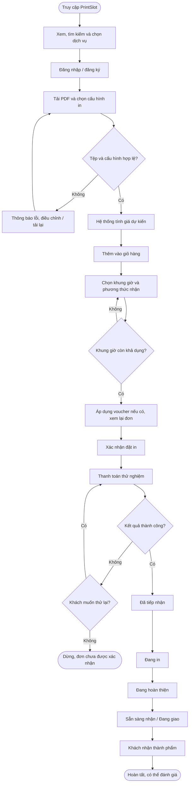

# Quy trình nghiệp vụ

**Người phụ trách:** Hưng (NV6)  
**Dự án:** PrintSlot – Website đặt dịch vụ in ấn tài liệu theo yêu cầu dành cho học sinh, sinh viên  
**Quy trình chính:** Đặt dịch vụ in ấn và theo dõi trạng thái đơn hàng

## 1. Mục tiêu và phạm vi

Mô tả hành trình đặt in trên PrintSlot, từ lúc người dùng truy cập website, lựa chọn dịch vụ, tải tệp PDF, cấu hình in, nhận báo giá, chọn thời gian nhận, xác nhận và thanh toán thử nghiệm đến khi theo dõi và nhận thành phẩm. Quy trình bám sát vai trò người dùng và các chức năng **F01–F23** trong `REQUIREMENTS.md` (NV5).

**Phạm vi MVP:** Đặt in qua website; thanh toán trong **môi trường thử nghiệm/sandbox, không giao dịch tiền thật**; nhận tại tiệm hoặc giao trong khu vực được cấu hình (không tích hợp API vận chuyển). Các tính năng in hỏa tốc, đặt dịch vụ B2B riêng và thanh toán thật không thuộc quy trình MVP.

## 2. Vai trò tham gia

| Vai trò | Nhiệm vụ trong quy trình |
| --- | --- |
| **Khách chưa đăng nhập** | Xem, tìm kiếm, lọc danh mục dịch vụ và xem chi tiết; cần đăng nhập để thực hiện đặt in. |
| **Khách hàng** | Tải PDF, chọn cấu hình và số lượng, xem giá, quản lý giỏ hàng, chọn khung giờ/giao nhận, đặt đơn, thanh toán thử nghiệm và theo dõi đơn của mình. |
| **Hệ thống PrintSlot** | Kiểm tra dữ liệu, tính giá, kiểm tra khung giờ, ghi nhận kết quả thanh toán thử nghiệm, lưu đơn và hiển thị trạng thái. |
| **Nhân viên vận hành tiệm in** | Kiểm tra tệp/đơn được phân công, in và hoàn thiện, cập nhật tiến độ, xác nhận bàn giao. |
| **Quản trị viên** | Cấu hình dịch vụ, bảng giá, lịch và sức chứa, voucher; giám sát đơn theo quyền được cấp. |

## 3. Các bước quy trình nghiệp vụ chính

| Bước | Người thực hiện | Hoạt động / Kết quả | Chức năng liên quan (NV5) |
| :---: | --- | --- | --- |
| **1** | Khách truy cập | Truy cập PrintSlot, xem danh mục hoặc tìm kiếm/lọc dịch vụ in ấn theo nhu cầu. | **F01, F03** |
| **2** | Khách truy cập | Mở trang chi tiết để xem mô tả, giá tham khảo, tùy chọn in; có thể chọn combo có sẵn. | **F02, F10** |
| **3** | Khách hàng | Đăng ký hoặc đăng nhập để sử dụng chức năng đặt in. | **F04** |
| **4** | Khách hàng / Hệ thống | Tải tệp PDF cần in. Hệ thống kiểm tra định dạng, giới hạn dung lượng và từ chối tệp không hợp lệ. | **F05, F23** |
| **5** | Khách hàng | Chọn số bản, khổ giấy, loại giấy, màu/đen trắng, một/hai mặt, đóng gáy hoặc các tùy chọn phù hợp dịch vụ. | **F06** |
| **6** | Hệ thống / Khách hàng | Hệ thống tính **giá dự kiến** theo cấu hình, số lượng và bảng giá. Nếu có gợi ý tiết kiệm theo quy tắc, khách tự quyết định áp dụng hoặc giữ nguyên. | **F07, F08** |
| **7** | Khách hàng | Thêm mục in vào giỏ hàng; xem, sửa số lượng/cấu hình hoặc xóa mục nếu cần. | **F09** |
| **8** | Khách hàng / Hệ thống | Chọn ngày và **khung giờ nhận**. Hệ thống kiểm tra lịch hoạt động, sức chứa và chỉ cho xác nhận khung giờ hợp lệ. | **F11** |
| **9** | Khách hàng | Chọn **nhận tại tiệm** hoặc **giao trong khu vực hỗ trợ**; nhập thông tin giao nhận phù hợp. Hệ thống hiển thị phí giao dự kiến (nếu có). | **F12** |
| **10** | Khách hàng / Hệ thống | Nhập voucher nếu có; hệ thống kiểm tra điều kiện, cập nhật tổng tiền. Khách xem lại tệp, cấu hình, thời gian, thông tin nhận và chi phí. | **F13, F09** |
| **11** | Khách hàng / Hệ thống | Khách xác nhận đặt in. Hệ thống kiểm tra lại dữ liệu bắt buộc, giá và khung giờ còn khả dụng trước khi tiếp tục. | **F09, F11, F23** |
| **12** | Khách hàng / Hệ thống | Thực hiện **thanh toán thử nghiệm**. Nếu kết quả thành công, hệ thống ghi nhận đơn, tạo mã đơn và chuyển sang **Đã tiếp nhận**; nếu thất bại/hủy, thông báo để khách xử lý, không xem là đơn đã thanh toán thành công. | **F14, F15** |
| **13** | Nhân viên vận hành | Tiếp nhận đơn được phân công, kiểm tra tệp; tiến hành in và hoàn thiện, cập nhật lần lượt **Đang in → Đang hoàn thiện → Sẵn sàng nhận / Đang giao** tùy phương thức giao nhận. | **F20** |
| **14** | Khách hàng / Nhân viên | Khách tra cứu trạng thái trong tài khoản, nhận thành phẩm tại tiệm hoặc theo phương thức giao đã chọn. Khi bàn giao thành công, nhân viên cập nhật **Hoàn tất**; khách có thể đánh giá dịch vụ sau đó. | **F15, F20, F18** |

**Kết quả đầu ra:** Một đơn in có mã đơn, thông tin dịch vụ và cấu hình, giá trị thanh toán thử nghiệm, khung giờ/phương thức nhận, lịch sử và trạng thái xử lý để khách hàng tra cứu.

## 4. Sơ đồ quy trình nghiệp vụ

## 5. Trạng thái đơn hàng

| Trạng thái | Ý nghĩa |
| --- | --- |
| **Đã tiếp nhận** | Đơn được ghi nhận sau kết quả thanh toán thử nghiệm thành công và sẵn sàng để cửa hàng xử lý. |
| **Đang in** | Nhân viên đã kiểm tra thông tin cần thiết và bắt đầu thực hiện in. |
| **Đang hoàn thiện** | Tài liệu đang được sắp xếp, kiểm tra, đóng gáy/đóng bìa hoặc gia công (nếu áp dụng). |
| **Sẵn sàng nhận** | Thành phẩm có thể đến lấy tại tiệm. |
| **Đang giao** | Đơn được xử lý theo phương thức giao hàng đã chọn; MVP chỉ ghi nhận/cập nhật trạng thái, không theo dõi qua API hãng vận chuyển. |
| **Hoàn tất** | Thành phẩm đã được bàn giao và đơn được xác nhận kết thúc. |

**Luồng chuẩn:** `Đã tiếp nhận → Đang in → Đang hoàn thiện → Sẵn sàng nhận / Đang giao → Hoàn tất`.

Trường hợp thanh toán chưa thành công hoặc đơn được yêu cầu hủy là **ngoại lệ** cần lưu riêng kết quả xử lý; không tự động chuyển đơn sang `Đã tiếp nhận` như đã thanh toán. Tên và điều kiện của các trạng thái phụ (nếu thêm) sẽ được nhóm thống nhất ở giai đoạn thiết kế chi tiết.

## 6. Trường hợp ngoại lệ và quy tắc cần lưu ý

| Tình huống | Hướng xử lý trong MVP | Chức năng |
| --- | --- | --- |
| **PDF sai định dạng hoặc vượt dung lượng** | Hiển thị lỗi, yêu cầu tải tệp hợp lệ trước khi tiếp tục. | F05, F23 |
| **Cấu hình in không hợp lệ** | Yêu cầu khách điều chỉnh; chỉ tính giá và cho xác nhận khi dữ liệu hợp lệ. | F06, F07 |
| **Khung giờ đã hết chỗ** | Không xác nhận khung đó; cho khách chọn khung giờ khác còn khả dụng. | F11 |
| **Voucher không hợp lệ** | Không áp dụng giảm giá, hiển thị lý do và giữ tổng tiền theo giá hợp lệ. | F13 |
| **Thanh toán thử nghiệm thất bại hoặc bị hủy** | Ghi nhận kết quả, thông báo và cho khách thực hiện lại theo luồng; không ghi nhận thanh toán tiền thật. | F14 |
| **Nhân viên phát hiện tệp có vấn đề khi xử lý** | Ghi nhận sự cố và yêu cầu khách bổ sung/chỉnh sửa tệp theo quyền và quy trình được nhóm thống nhất. | F20 |
| **Khách yêu cầu hủy đơn** | Kiểm tra điều kiện hủy, ghi nhận kết quả; việc hoàn tiền (nếu có) xử lý/ghi nhận thủ công trong MVP. | F16 |
| **Dịch vụ đặc thù chưa thể tính giá tự động** | Khách gửi yêu cầu báo giá riêng; đây là nhánh phụ, không thuộc luồng đặt in tiêu chuẩn ở trên. | F17 |

**Nguyên tắc chung:** Khách hàng chỉ xem được tệp và đơn hàng của mình; nhân viên chỉ truy cập đơn được phân công; quản trị viên thao tác trong phạm vi phân quyền. Chức năng quản lý bảng giá, lịch và sức chứa (F19, F21) là bước **cấu hình trước khi vận hành**, không phải thao tác của khách trong mỗi đơn đặt in.

