# Phân tích website tương tự

## Danh sách website

| Ký hiệu | Tên | URL | Người khảo sát |
|---|---|---|---|
| A | In Sài Gòn | [https://insaigon.vn/](https://insaigon.vn/) | Nhi |
| B | In Nhanh Co | [https://innhanh.co/](https://innhanh.co/) | Nhi |
| C | In KTS Đại Dương (In Ấn Đại Dương) | [https://www.inandaiduong.com/](https://www.inandaiduong.com/) | Phương |

## Bảng so sánh

| Tiêu chí | Website A: In Sài Gòn | Website B: In Nhanh Co | Website C: In KTS Đại Dương | Đề xuất cho dự án PrintSlot |
|---|---|---|---|---|
| Trang chủ | Điểm mạnh: Chia nội dung thành các nhóm như dịch vụ mới, sản phẩm được quan tâm và combo, giúp khách có nhiều cách tìm sản phẩm. Có phần yêu cầu báo giá, phù hợp khách cần in theo yêu cầu riêng.  Chưa ghi nhận hạn chế cụ thể trong phạm vi khảo sát. | Điểm mạnh: Giới thiệu từng dịch vụ kèm đường dẫn bảng giá, giúp khách vừa hiểu dịch vụ vừa tìm được thông tin chi phí. Có đánh giá khách hàng và bài viết kiến thức để hỗ trợ người chưa quen đặt in.  Chưa ghi nhận hạn chế cụ thể trong phạm vi khảo sát. | Điểm mạnh: Bố cục phân chia rõ ràng thành nhiều khối nội dung trực quan: Banner giới thiệu xưởng in, Danh mục ấn phẩm (Poster, Standee, Tờ rơi, Bag, Hộp cứng), Mẫu bao lì xì theo mùa, Sản phẩm tiêu biểu và khu vực “Fast Sale” (bán nhanh). Cung cấp minh bạch quy trình sản xuất (8 bước từ tiếp nhận, làm mẫu đến giao hàng), khối hướng dẫn đặt hàng/thanh toán/bảo mật, cùng danh sách hình ảnh/hotline của đội ngũ nhân viên kinh doanh để khách hàng dễ liên hệ hỗ trợ trực tiếp. Tích hợp video giới thiệu xưởng, hoạt động công ty và logo các đối tác tin cậy giúp tăng độ uy tín thương hiệu.  Điểm cần cải thiện: Trang chủ có chiều dài quá lớn với quá nhiều khối hình ảnh (hạng mục thi công, video, đối tác, sản phẩm tiêu biểu) khiến người dùng phải cuộn trang liên tục. | Thiết kế giao diện hiện đại, tối giản và tập trung vào hành vi đặt in nhanh của sinh viên/người đi làm.  Tích hợp ngay Form "Đặt in tài liệu nhanh" ở vị trí trung tâm trang chủ (Cho phép: Upload file PDF/Word -> Chọn số trang/mặt in -> Hệ thống báo giá tự động tức thì).  Hiển thị banner cam kết thời gian hoàn thành (Giao hỏa tốc 2h / Đặt lịch hẹn nhận hàng tại quầy). |
| Danh mục sản phẩm | Điểm mạnh: Phân loại theo loại ấn phẩm và có các lựa chọn như namecard in nhanh, in ghép giá rẻ. Cách chia này phù hợp với khách lựa chọn dựa trên thời gian nhận hàng và ngân sách.  Điểm cần cải thiện: Khách mới có thể chưa hiểu “in nhanh” và “in ghép” khác nhau thế nào. Nên bổ sung mô tả ngắn về thời gian, số lượng phù hợp và chi phí để khách chọn mà không cần hỏi lại. | Điểm mạnh: Có nhiều nhóm sản phẩm cụ thể như danh thiếp, bao thư, tem nhãn và túi giấy, giúp khách tìm theo món cần in.  Điểm cần cải thiện: Danh mục đặt loại sản phẩm cạnh công nghệ in như Digital Print, Offset; một số sản phẩm còn được đặt tên theo địa phương. Cách tổ chức này khiến khách khó phân biệt đâu là khác biệt về sản phẩm, đâu chỉ là cách gọi dịch vụ. | Điểm mạnh: Phân loại phong phú, trực quan cả trên Menu (In KTS, In UV, In Offset, Thi công) lẫn khối icon trang chủ (Poster, Standee, Decal, Tờ rơi, Túi giấy, Hộp cứng), giúp khách dễ tìm theo ấn phẩm hoặc công nghệ in.  Điểm cần cải thiện: Thiên về doanh nghiệp và quảng cáo, chưa có nhóm danh mục chuyên biệt cho học sinh - sinh viên (tài liệu, slide, khóa luận, …). | Phân loại danh mục theo đúng nhu cầu học tập và làm việc thực tế:  + Tài liệu học tập/Làm việc: Slide thuyết trình, Giáo trình/Ebook, Khóa luận/Báo cáo nhóm, Đề thi ôn tập.  + Ấn phẩm sự kiện/Chuyên biệt: Poster, Decal/Sticker, Standee, Catalogue.  + Combo tiết kiệm: Combo Bảo vệ khóa luận (In màu bìa + Keo nhiệt/Gáy mạ vàng), Combo In PP Standee sự kiện. |
| Tìm kiếm và lọc | Điểm mạnh: Có tìm kiếm theo tên và các thuộc tính lọc như loại giấy, số lượng, cán màng, thời gian in. Đây là các yếu tố ảnh hưởng trực tiếp đến nhu cầu đặt in, nên có ích hơn việc chỉ chia theo tên sản phẩm.  Điểm cần cải thiện: Ô tìm kiếm hướng dẫn nhập tiếng Việt không dấu, chưa thuận tiện với thói quen gõ thông thường. Danh sách thuộc tính khá rộng, nên chỉ hiện các lựa chọn phù hợp với danh mục đang xem để tránh gây rối. | Điểm mạnh: Có lọc theo danh mục, xem nhanh và so sánh, giúp khách tham khảo nhiều lựa chọn mà không phải mở từng trang.  Điểm cần cải thiện: Khả năng lọc sâu theo giấy, kích thước và thời gian in chưa thể hiện rõ trong nội dung khảo sát. Các chức năng so sánh sẽ hữu ích hơn nếu tập trung vào những thông số này, thay vì chủ yếu là tên và phần mô tả sản phẩm. | Điểm mạnh: Ô tìm kiếm được đặt nổi bật ở chính giữa thanh Header với gợi ý sẵn "Nhập sản phẩm, dịch vụ bạn cần tìm", giúp người dùng dễ dàng thao tác tra cứu nhanh theo từ khóa. Điểm cần cải thiện: Thiếu bộ lọc nâng cao theo các thuộc tính đặc thụ của ngành in (như khổ giấy A4/A5, loại giấy, kiểu đóng gáy, in màu/trắng đen), khiến người dùng khó lọc sản phẩm chính xác theo tiêu chí kỹ thuật. | Hỗ trợ thanh tìm kiếm thông minh theo từ khóa tên tài liệu hoặc loại ấn phẩm. Bộ lọc đa thuộc tính chuyên biệt cho ngành in: Lọc theo khổ giấy (A4, A5, A3), loại giấy (Fort 70gsm, Couche 150gsm...), kiểu in (Màu / Trắng đen; 1 mặt / 2 mặt), kiểu đóng gáy (Bấm kim, Lò xo, Keo nhiệt/Bìa mạ vàng). |
| Chi tiết sản phẩm | Điểm mạnh: Trang namecard in nhanh nêu rõ loại giấy, kích thước, số mặt in và số lượng trong một hộp. Thông tin này giúp khách hiểu giá đang áp dụng cho quy cách nào, hạn chế đặt nhầm. Có Zalo để hỏi thêm yêu cầu riêng.  Điểm cần cải thiện: Chưa thấy hướng dẫn gửi file thiết kế rõ ràng ngay cạnh phần đặt mua trên trang khảo sát. Nên giải thích cách gửi file và duyệt mẫu để khách biết cần chuẩn bị gì trước khi đặt. | Điểm mạnh: Cho khách chọn giấy, xác định đã có file hay cần thiết kế, tải file và nhập yêu cầu ngay tại sản phẩm (được minh họa tại hình 2.6). Đây là điểm đáng học hỏi vì tập hợp thông tin đơn in tại một nơi, giảm việc trao đổi bổ sung.  Chưa ghi nhận hạn chế cụ thể trong phạm vi khảo sát. | Điểm mạnh: Trang sản phẩm cung cấp bài viết giới thiệu chi tiết và bài bản: có hình ảnh minh họa thực tế sắc nét, giải thích rõ khái niệm, các chất liệu giấy sử dụng (Kraft, Couche, Duplex, giấy mỹ thuật) và ứng dụng thực tế của ấn phẩm. Cung cấp danh sách thông tin liên hệ đa kênh cụ thể (Email, SĐT Zalo cá nhân của từng Nhân viên kinh doanh, Hotline và địa chỉ xưởng) ngay trên trang để hỗ trợ khách hàng hỏi đáp quy cách. Điểm cần cải thiện: Nội dung trang chi tiết sản phẩm thuần túy là bài viết thông tin (dạng Blog/ Catalogue), hoàn toàn không niêm yết bảng giá, không có khung chọn tùy chỉnh quy cách in (kích thước, số lượng, định lượng giấy, kiểu đóng gáy) và không có công cụ cho phép tải/xem trước (Preview) file tài liệu. | Tích hợp công cụ Upload trực tiếp file tài liệu (PDF, Word, PPT).  Thuật toán tự động đếm số trang (Page count) trong file PDF người dùng gửi lên.  Cho phép Xem trước (Preview) file tài liệu trực tiếp trên giao diện web.  Báo giá tự động cập nhật theo thời gian thực ngay khi người dùng thay đổi các tùy chọn quy cách in |
| Giỏ hàng và đặt hàng | Điểm mạnh: Có nút thêm giỏ, trang giỏ hàng, tổng tiền và liên kết thanh toán, tạo các bước cơ bản để khách đặt sản phẩm trực tuyến.  Điểm cần cải thiện: Cần làm rõ mối liên hệ giữa đặt hàng và xử lý file thiết kế: gửi file lúc nào, duyệt mẫu ở bước nào, khi nào bắt đầu in. Với sản phẩm cá nhân hóa, chỉ có bước chọn hàng và thanh toán chưa đủ giúp khách hiểu toàn bộ quy trình. | Điểm mạnh: Giỏ hàng trình bày rõ quy cách in, đơn giá, số lượng và thành tiền; có nút sửa tùy chọn, đổi số lượng và xóa sản phẩm, giúp khách kiểm tra và điều chỉnh đơn trước khi thanh toán. Sau khi đặt hàng, website cung cấp mã đơn và hướng dẫn chuyển khoản.  Điểm cần cải thiện: Thông báo yêu cầu thanh toán trong khoảng 5 phút chưa giải thích điều gì xảy ra khi hết giờ, có thể khiến khách vội xác nhận khi chưa kiểm tra kỹ đơn. Trang hướng dẫn chuyển khoản chưa thấy mã QR điền sẵn số tiền và mã đơn, nên bổ sung để giảm thao tác nhập thủ công. | Điểm mạnh: Cung cấp thông tin quy trình đặt hàng trực tiếp đa kênh rất rõ ràng và chi tiết (gửi file qua Email công ty, nhắn Zalo trực tiếp cho từng nhân viên kinh doanh, gọi Hotline hoặc đến tận văn phòng/xưởng in). Việc trao đổi trực tiếp qua Zalo/Email giúp nhân viên hỗ trợ kiểm tra file in, tư vấn chất liệu và duyệt file mẫu kỹ lưỡng trước khi sản xuất.  Điểm cần cải thiện: Website hoàn toàn không có tính năng Giỏ hàng (Cart) hay Thanh toán trực tuyến (Checkout). Quy trình đặt hàng hoàn toàn thủ công và cồng kềnh: Khách hàng điền thông tin/gửi file -> Nhân viên kinh doanh tiếp nhận và báo giá lại -> Chuyển khoản đặt cọc -> Mới tiến hành in. Điều này gây mất thời gian trung gian, không tối ưu cho nhu cầu đặt in nhanh tài liệu lẻ của sinh viên. | Bước 1: Tải file & Chọn cấu hình in (Hệ thống tính giá tự động).  Bước 2: Chọn thời gian & Khung giờ nhận (Đặt lịch hẹn lấy tại tiệm hoặc Ship hỏa tốc). Bước 3: Xem lại giỏ hàng và áp dụng Mã giảm giá/Voucher sinh viên.  Bước 4: Thanh toán trực tuyến đa kênh (Mã QR điền sẵn số tiền & nội dung / Ví MoMo) hoặc Đặt cọc.  Bước 5: Màn hình theo dõi trạng thái đơn hàng thời gian thực (Đã tiếp nhận -> Đang in -> Hoàn thiện -> Sẵn sàng nhận/đang giao). |
| Điểm có thể cải thiện | Báo giá chưa tự động hoàn toàn theo file PDF thực tế của khách hàng, vẫn tốn thời gian trao đổi và chốt giá thủ công qua Zalo/Hotline. | Giao diện và quy trình đặt hàng thiên về ấn phẩm thương mại/doanh nghiệp số lượng lớn, chưa tối ưu trải nghiệm cho sinh viên cần in lẻ vài chục trang tài liệu/slide. | Thiếu hoàn toàn tính năng Giỏ hàng và Checkout tự động; quy trình đặt hàng bị phụ thuộc 100% vào việc nhắn tin/gửi mail qua lại với nhân viên kinh doanh. | Tính giá tự động tức thì: Khắc phục hoàn toàn việc phải nhắn Zalo/Email chờ báo giá thủ công bằng thuật toán đọc file PDF tự động.  Gợi ý cấu hình tiết kiệm: Tự động đề xuất chuyển từ in 1 mặt sang 2 mặt hoặc in trắng đen cho các trang không cần thiết để tối ưu chi phí cho sinh viên.  Đặt lịch hẹn nhận hàng thông minh: Cho phép chọn khung giờ đến lấy hàng giúp sinh viên chủ động chạy deadline mà không phải xếp hàng chờ đợi. |

## Điều đáng học hỏi / chưa phù hợp / lý do chọn

- **Điều đáng học hỏi:** In Sài Gòn có bộ lọc theo quy cách in; In Nhanh Co cho khách tùy chỉnh giấy, tải file và ghi yêu cầu ngay tại trang sản phẩm; In KTS Đại Dương công khai quy trình sản xuất và nhiều kênh hỗ trợ trực tiếp.
- **Điểm chưa phù hợp:** Các quy trình vẫn có bước cần trao đổi để báo giá hoặc xác nhận file; một số dịch vụ thiên về ấn phẩm thương mại, chưa tối ưu cho sinh viên in tài liệu lẻ, cần biết giá và thời điểm nhận hàng nhanh.
- **Lý do lựa chọn và định hướng áp dụng:** Ba website đại diện cho các cách tổ chức danh mục, hỗ trợ cấu hình đơn in và đặt hàng khác nhau. PrintSlot đề xuất lấy nhu cầu in tài liệu học tập/làm việc làm trọng tâm, tích hợp tải file, cấu hình, tính giá, chọn khung giờ nhận và theo dõi trạng thái đơn.

## Hình ảnh minh họa

### Hình 2.1: Trang chủ website In Sài Gòn

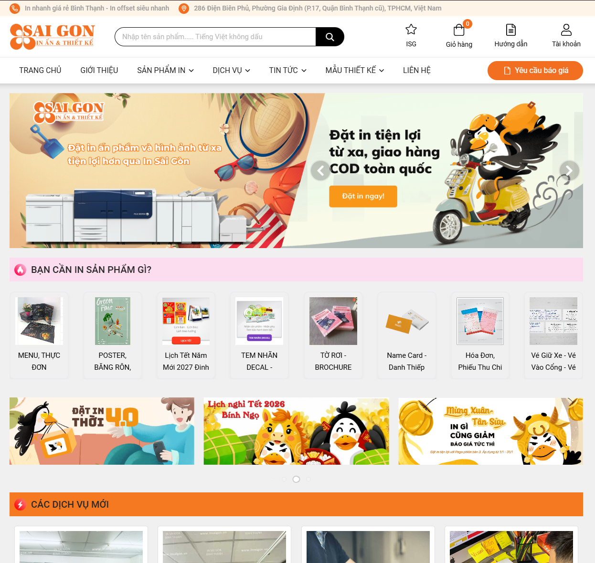

Nguồn: [In Sài Gòn](https://insaigon.vn/) (n.d.).

### Hình 2.2: Thao tác tìm kiếm với từ khóa “hồ sơ” trên website In Sài Gòn

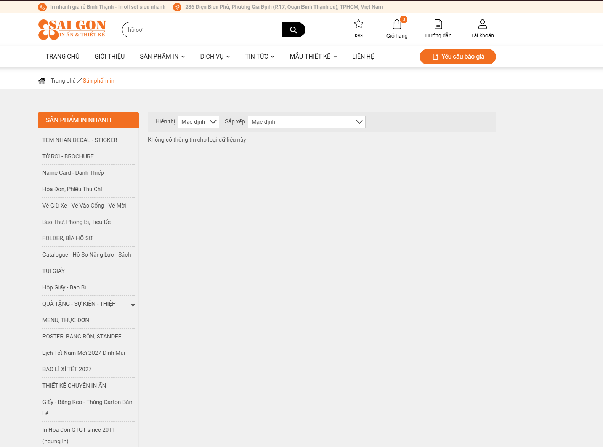

Nguồn: [In Sài Gòn](https://insaigon.vn/) (n.d.).

### Hình 2.3: Trang sản phẩm chi tiết “Namecard in nhanh” của website In Sài Gòn

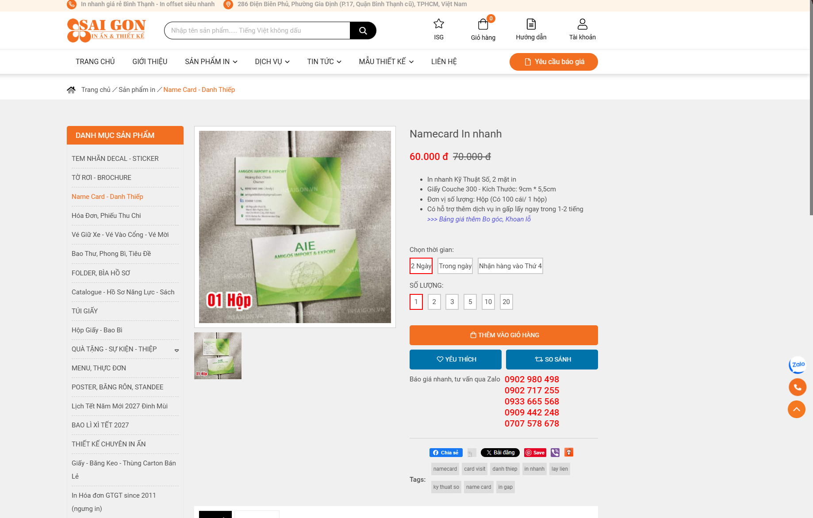

Nguồn: [In Sài Gòn](https://insaigon.vn/) (n.d.).

### Hình 2.4: Trang chủ website In Nhanh Co

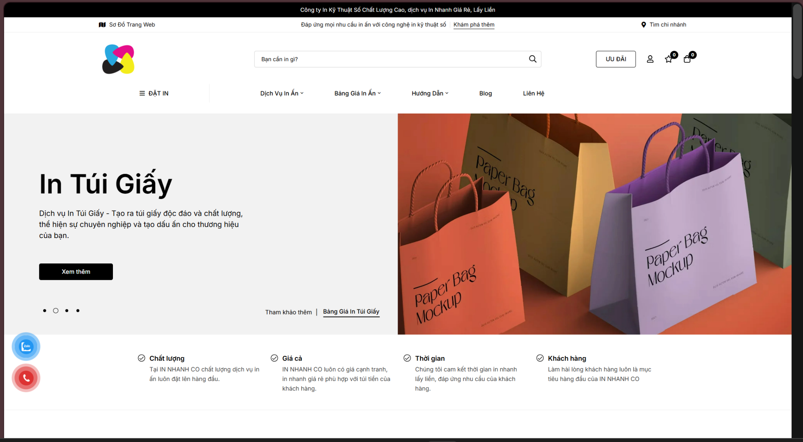

Nguồn: [In Nhanh Co](https://innhanh.co/) (n.d.).

### Hình 2.5: Danh mục sản phẩm của website In Nhanh Co

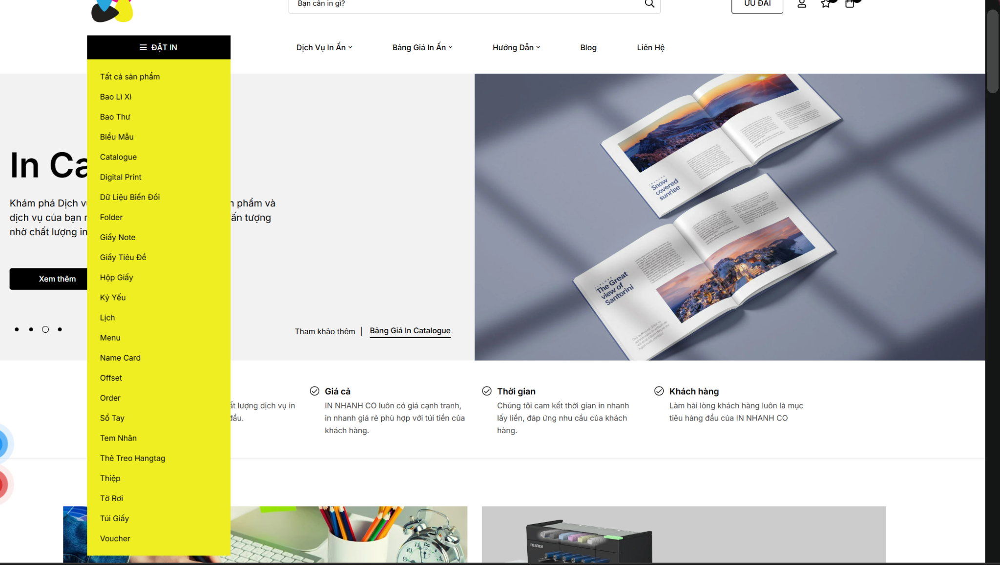

Nguồn: [In Nhanh Co](https://innhanh.co/) (n.d.).

### Hình 2.6: Giao diện sản phẩm chi tiết In Name Card Lấy Liền của website In Nhanh Co

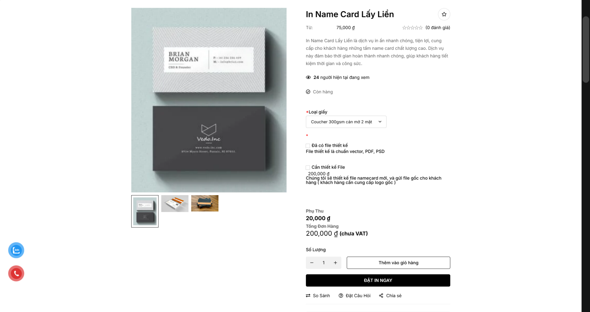

Nguồn: [In Nhanh Co](https://innhanh.co/) (n.d.).

### Hình 2.7: Giao diện trang Giỏ hàng của website In Nhanh Co

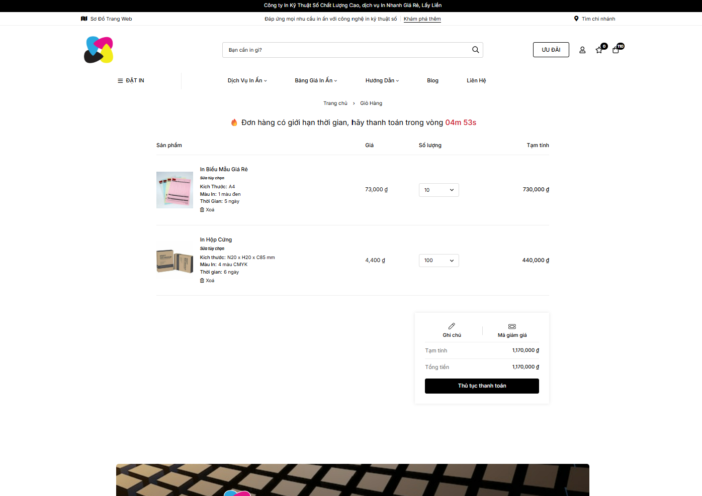

Nguồn: [In Nhanh Co](https://innhanh.co/) (n.d.).

### Hình 2.8: Trang chủ website In Ấn Đại Dương

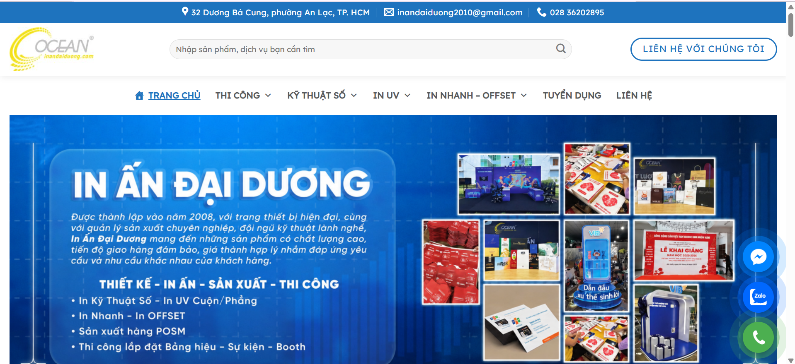

Nguồn: [In KTS Đại Dương (In Ấn Đại Dương)](https://www.inandaiduong.com/) (n.d.).

### Hình 2.9: Danh mục ấn phẩm của website In Ấn Đại Dương

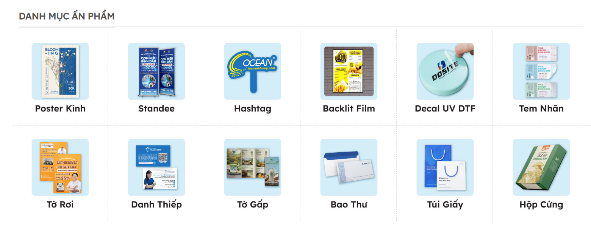

Nguồn: [In KTS Đại Dương (In Ấn Đại Dương)](https://www.inandaiduong.com/) (n.d.).

### Hình 2.10: Giao diện sản phẩm chi tiết của In Ấn Đại Dương

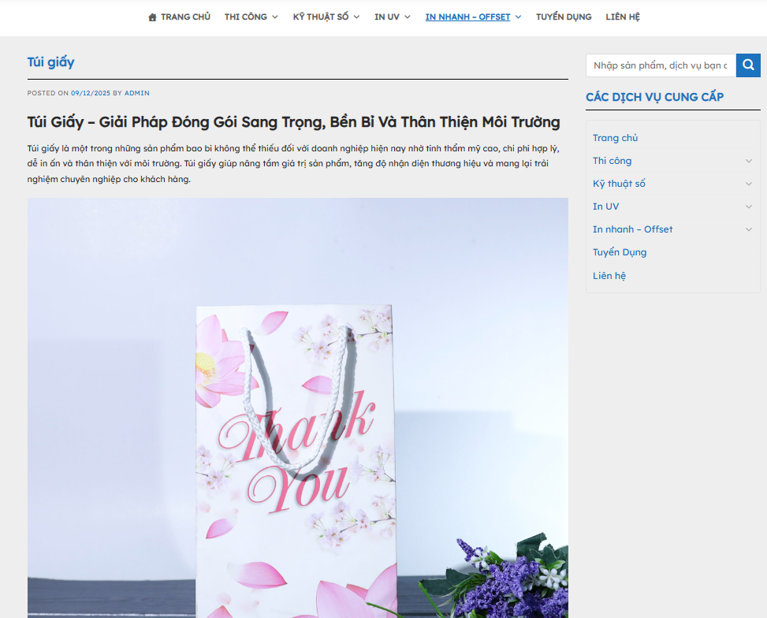

Nguồn: [In KTS Đại Dương (In Ấn Đại Dương)](https://www.inandaiduong.com/) (n.d.).

### Hình 2.11: Hướng dẫn đặt hàng của In Ấn Đại Dương

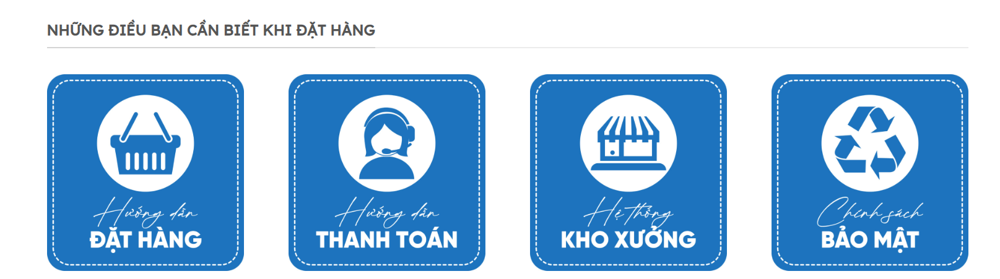

Nguồn: [In KTS Đại Dương (In Ấn Đại Dương)](https://www.inandaiduong.com/) (n.d.).
